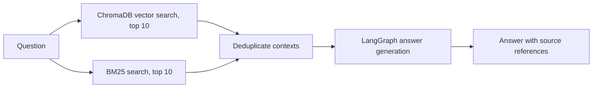

# Vietnamese Legal RAG

A Vietnamese legal-document question-answering prototype built with hybrid retrieval. It combines ChromaDB vector search with BM25, then uses a LangGraph workflow and an LLM to produce grounded answers with source references.

> This is a software project and evaluation prototype, not legal advice. Check the current, official text of a law before relying on it.

**Stack:** Python · FastAPI · LangGraph · LangChain · ChromaDB · BM25 · React · Docker

**Vietnamese documentation:** [README.vi.md](README.vi.md)

## What it does

- Loads six Vietnamese legal documents from `data/` and splits them into overlapping text chunks.
- Uses the `bkai-foundation-models/vietnamese-bi-encoder` embedding model for vector search.
- Retrieves up to 10 ChromaDB and 10 BM25 results, then removes duplicate chunks.
- Runs a LangGraph retrieval and answer-generation flow; the prompt asks the model to cite the source document and relevant article.
- Serves a FastAPI backend with a React frontend; Docker Compose is available for local deployment.

## Architecture



## Evaluation

A small, article-targeted pilot set contains 30 questions derived from the six source documents. The hybrid retriever returned the expected source file and article in its top 20 results for **27/30 questions (90%)**.

This is a retrieval-only result on a small, corpus-derived set. It is not a held-out benchmark and does not measure answer correctness, citation faithfulness, or legal accuracy. The question set and per-question retrieval results are in [Legal_RAG_30Q_Evaluation.xlsx](Legal_RAG_30Q_Evaluation.xlsx).

## Run locally

### Docker Compose

```bash
git clone https://github.com/chinghia689/vietnamese-legal-rag.git
cd vietnamese-legal-rag
cp .env.example .env
# Set GROQ_API_KEY in .env
docker compose up --build
```

The API and frontend ports are defined in `docker-compose.yml`. Open the API documentation at `/docs` on the backend port.

### Development

```bash
python -m venv .venv
source .venv/bin/activate
pip install -r requirements.txt
cp .env.example .env
# Set GROQ_API_KEY in .env
python main.py
```

In another terminal:

```bash
cd frontend
npm ci
npm run dev
```

The first backend startup may download the embedding model and build the local ChromaDB index from `data/`. Generated database files are intentionally excluded from Git.

## Configuration

Copy `.env.example` to `.env` and provide `GROQ_API_KEY`. Keep real credentials out of source control. The configured LLM is created by the application in `rag/graph.py`.

## Repository layout

- `rag/` — document loading, embeddings, hybrid retrieval, and LangGraph flow
- `data/` — source DOCX files used by the prototype
- `frontend/` — React/Vite client
- `Legal_RAG_30Q_Evaluation.xlsx` — pilot questions and retrieval-only results

## Limitations

- The corpus is a fixed set of six documents and is not synchronized with official legal updates.
- The 30-question evaluation set is small and derived from the corpus; answer accuracy has not been measured.
- The ChromaDB index is built locally from the supplied documents and embedding model.
- No license is provided yet; verify rights for the code and bundled documents before reuse.
